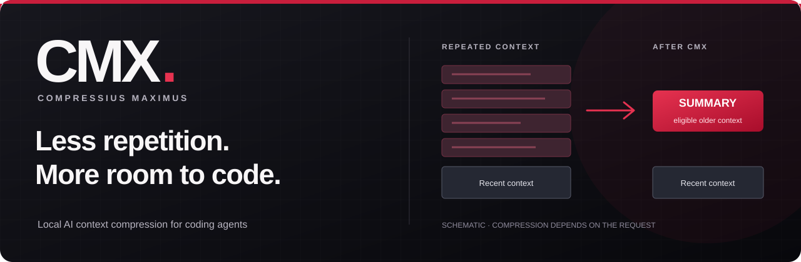

<p align="center">
  <a href="https://compressi.us/">
    
  </a>
</p>

<p align="center">
  <strong>Free to use · Runs locally · Linux, macOS &amp; Windows</strong>
</p>

<p align="center">
  <a href="https://compressi.us/downloads"><strong>Install CMX</strong></a> &nbsp;·&nbsp;
  <a href="https://docs.compressi.us/quickstart">Quickstart</a> &nbsp;·&nbsp;
  <a href="https://docs.compressi.us/">Documentation</a> &nbsp;·&nbsp;
  <a href="https://github.com/compressius/cmx/releases">Releases</a>
</p>

# Compressius Maximus (CMX)

[Compressius Maximus](https://compressi.us/) is a free, local AI context compression gateway for coding agents. It reduces repeated input tokens in long coding sessions by compressing eligible older context before requests reach your model provider.

Keep working in Codex, OpenCode, or another supported client. CMX runs on your machine, between your coding agent and the provider you already use. Local compression needs no CMX account.

## Give repeated context less room

Long coding sessions accumulate file reads, tool output, and conversation history. CMX can prune duplicate or superseded output and summarize eligible older context, then reuse cached summaries across requests.

| What CMX does | What that means for your session |
| :--- | :--- |
| Compresses eligible history | Less repeated context in later requests. |
| Protects instructions and recent work | System and developer instructions, recent context, and protected tool exchanges stay intact. |
| Checks summaries before applying them | Proposals must pass policy checks for structure, protected content, and expected benefit. |
| Reports usage | Inspect local token statistics; sign in for the account dashboard and detailed statistics. |

[How context compression works](https://docs.compressi.us/how-compression-works) · [How token savings are measured](https://docs.compressi.us/understanding-savings)

## Install CMX

For Linux and macOS:

```sh
curl -fsSL https://compressi.us/install.sh | sh
```

<details>
<summary>Windows, npm, and portable downloads</summary>

On Windows, run in PowerShell:

```powershell
iwr -useb https://compressi.us/install.ps1 | iex
```

Or install with npm (Node.js 18+), then run guided setup:

```sh
npm install --global @compressius/cmx
cmx setup --ask-connect-ready
```

[All downloads](https://compressi.us/downloads) · [Installation guide](https://docs.compressi.us/installation) · [Release binaries and checksums](https://github.com/compressius/cmx/releases/latest)

</details>

The standalone installer runs setup and asks before connecting detected coding clients. Choose a connection, restart your client, and send a request. Run `cmx stats` to check that traffic is reaching the gateway.

Open `cmx` for the terminal interface. Run `cmx login` if you want the account dashboard. See the [quickstart](https://docs.compressi.us/quickstart) for connection checks and [how to restore direct routing](https://docs.compressi.us/uninstall).

## Use your coding tools

Follow the setup guide for [Codex](https://docs.compressi.us/providers/codex), [OpenCode](https://docs.compressi.us/providers/opencode), [Claude Code](https://docs.compressi.us/providers/claude-code), [Aider](https://docs.compressi.us/providers/aider), [Antigravity](https://docs.compressi.us/providers/antigravity), or [Cline](https://docs.compressi.us/providers/cline).

CMX supports compression for **OpenAI Chat Completions, OpenAI Responses, and Anthropic Messages**. Other clients can connect through a custom API base URL; support depends on the request format. See [client compatibility](https://docs.compressi.us/providers/overview), [custom client setup](https://docs.compressi.us/providers/custom-agents), and [model providers](https://docs.compressi.us/model-providers).

## Your requests stay on their intended route

```text
Your coding agent  →  CMX · 127.0.0.1:17322  →  Your model provider
```

CMX Cloud receives aggregate usage metrics. Prompts, responses, source code, session content, and provider keys are excluded. CMX keeps session records, cached summaries, and vault content locally; it does not save or log provider keys.

[Security and data handling](https://docs.compressi.us/security) · [Privacy policy](https://compressi.us/privacy)

Compression can lose detail, and token reductions do not guarantee a lower API bill. Session length, summary overhead, model pricing, and provider caching affect the result. CMX is free to use; your provider's normal charges still apply.

## Around the project

| Find | Go to |
| :--- | :--- |
| Official installers and compiled releases | [compressius/cmx](https://github.com/compressius/cmx) |
| Documentation source | [compressius/docs](https://github.com/compressius/docs) |
| Release history | [CMX changelog](https://compressi.us/changelog) |
| Help and feedback | [hello@compressi.us](mailto:hello@compressi.us) |
| License terms | [Proprietary Gratis License](https://github.com/compressius/cmx/blob/main/LICENSE) |

<p align="center">
  <a href="https://compressi.us/"><strong>compressi.us</strong></a> &nbsp;·&nbsp;
  <a href="https://compressi.us/downloads">Download CMX</a> &nbsp;·&nbsp;
  <a href="https://docs.compressi.us/">Read the docs</a>
</p>
